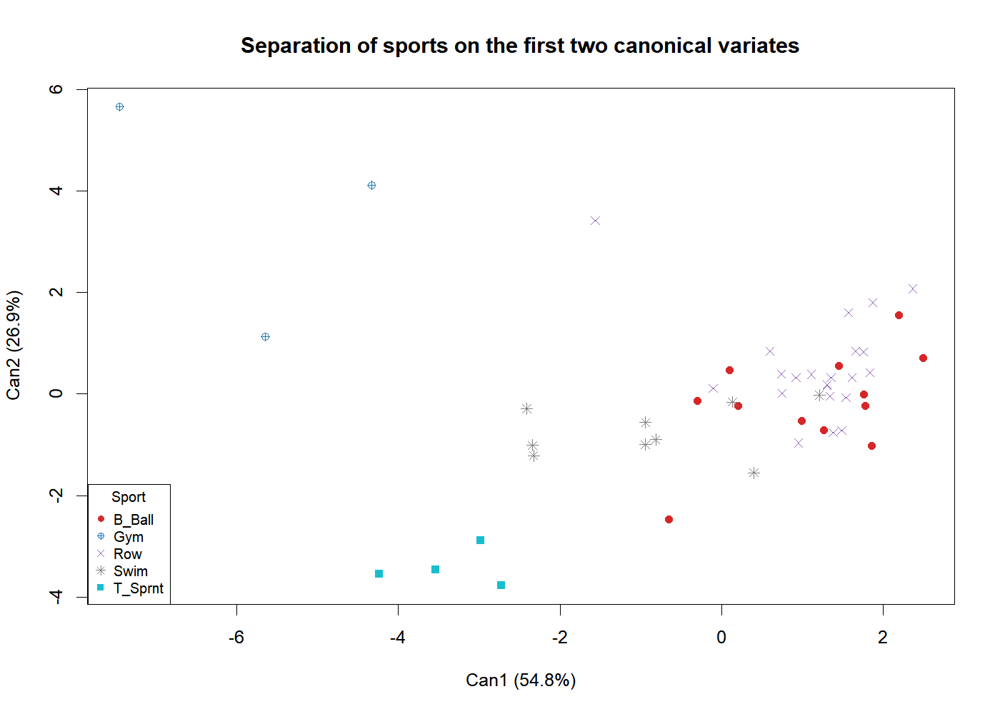

# Athlete Physiology: Data Quality Checks and Canonical Variate Analysis

This project checks the quality of 11 physiological and body measurements from 50 female elite athletes in five sports. It then uses Canonical Variate Analysis (CVA) to find which measurements best separate the sports. The pipeline is a set of numbered R scripts, so the whole analysis reruns from raw data with one command.

## Data

The data are the public Australian Institute of Sport (AIS) dataset (Cook & Weisberg, 1994), loaded from the R package [`DAAG`](https://cran.r-project.org/package=DAAG) as `DAAG::ais`. The analysis uses 50 female athletes from five sports: basketball (12), gymnastics (3), rowing (22), swimming (9) and sprinting (4). `R/01_load_data.R` lists the exact row indices.

| Variable | Description | Unit |
|---|---|---|
| rcc | Red cell count | 10^12/L |
| wcc | White cell count | 10^9/L |
| hc | Haematocrit | % |
| hg | Haemoglobin | g/dL |
| ferr | Plasma ferritin | µg/L |
| bmi | Body mass index | kg/m² |
| ssf | Sum of skin folds | mm |
| pcBfat | Body fat | % |
| lbm | Lean body mass | kg |
| ht | Height | cm |
| wt | Weight | kg |

## How to run

Requirements: R (4.4 or later) and the packages `DAAG`, `candisc` and `MASS`.

```r
install.packages(c("DAAG", "candisc"))
```

From the repository root:

```
Rscript run_all.R
```

The scripts run in order and write tables to `outputs/tables/` and figures to `outputs/figures/`. Each script can also be run on its own and loads what it needs.

| Script | What it does |
|---|---|
| `R/01_load_data.R` | Loads the 50 athletes from `DAAG::ais` |
| `R/02_data_quality_checks.R` | Completeness, duplicates, plausibility limits, internal consistency, within-sport outliers |
| `R/03_eda.R` | Group means and SDs, scatterplot matrix, boxplots by sport, strong correlations |
| `R/04_cva.R` | CVA with `candisc`: eigenvalues, coefficients, scores and the Can1–Can2 plot |
| `R/05_classify_new_athletes.R` | Places two athletes of unknown sport on Can1/Can2 and assigns the nearest group mean |
| `R/06_aper_split.R` | 70/30 train/test split (`set.seed(123)`), LDA, confusion matrix, error rate by sport |

## Data quality checks

These checks run before any modelling.

| Check | Rule | Result |
|---|---|---|
| Completeness | Missing values per variable | None missing |
| Duplicates | Rows identical on all 11 measurements | None |
| Plausibility | Values outside broad screening limits | None (limits in `02_data_quality_checks.R`) |
| BMI consistency | Recorded BMI vs weight / height² (tolerance 0.5) | All consistent |
| Lean mass consistency | Recorded LBM vs weight × (1 − body fat %) (tolerance 2 kg) | All consistent |
| Within-sport outliers | More than 3 SD from own sport's mean | 1 athlete (rower #28) |

Rower #28 is 156 cm tall and weighs 49.8 kg, far below the other rowers. Her values are plausible and internally consistent, so they are unlikely to be recording errors. Her profile fits a coxswain rather than a rower. She is kept in the analysis. She is also the rowing point that sits apart from the rowing cluster on the CVA plot.

The plausibility limits are wide screening bounds meant to catch recording errors. They are not clinical reference ranges.

## Results

**Group separation.** The first two canonical variates explain 81.8% of the between-group variation (Can1 54.8%, Can2 26.9%).

- Gymnasts, sprinters and swimmers form distinct clusters.
- Basketball players and rowers overlap.
- Lean body mass and weight dominate Can1. Lean body mass, BMI and height dominate Can2.



**Unknown athletes.** Athlete 1 is nearest to the rowing mean (distance 2.04; basketball is next at 2.73). Athlete 2 is nearest to the gymnastics mean (distance 0.93).

**Error rate.** On the 30% test set (15 athletes), LDA misclassifies 4 athletes: an apparent error rate (APER) of 26.7%, or 73.3% accuracy.

| Sport | In test set | Correct |
|---|---|---|
| Basketball | 3 | 3 |
| Rowing | 6 | 5 |
| Swimming | 3 | 1 |
| Sprinting | 3 | 2 |
| Gymnastics | 0 | – |

## Limitations

- **Small, unbalanced groups.** Gymnastics has 3 athletes and sprinting has 4. Rowing makes up 44% of the sample.
- **One random split.** With `set.seed(123)`, no gymnast reaches the test set and only one sprinter is in the training set. The 26.7% error rate therefore says nothing about gymnasts and is unstable for sprinters. Stratified splitting or leave-one-out cross-validation would give a more reliable estimate.
- **Strongly correlated measurements.** Examples are lean body mass with weight (r = 0.94) and skin folds with body fat (r = 0.95). This makes individual CVA coefficients unstable, so they should be read in groups rather than one by one.

## Credits

The analysis was first completed as a pair coursework project with Mingze Yuan (University of Reading, ST3MML, 2025). This repository is my own reorganised and extended version. I rewrote the code as modular scripts, added the data quality checks and the per-sport error breakdown, and verified that it reproduces the original results.
